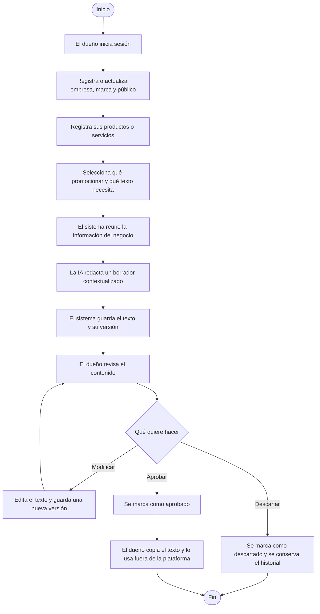

# GRUPO 07 – ContentAI-PYME

## Plataforma web para la generación contextualizada de contenido comercial para PYMES

### Integrantes

1. Diego.
2. Honores.
3. More.
4. Yoshua.
5. Franco.

### Plan de desarrollo

El stack es **PHP con Laravel para el backend, PostgreSQL para la base de datos y React + TypeScript para el frontend**.

El plazo del primer avance es el **miércoles 21 de octubre de 2026**. Incluye implementación, requisitos y diagramas.

La organización, las responsabilidades y las tareas de cada integrante están en el [reparto de trabajo del grupo](entregas/REPARTO_PARA_EL_GRUPO.md). Este documento conserva la descripción principal del proyecto.

### Descripción del proyecto

**ContentAI-PYME** será una plataforma web diseñada para apoyar a pequeñas y medianas empresas en la creación, gestión y evaluación de contenido comercial mediante modelos de inteligencia artificial.

La aplicación permitirá que cada empresa construya un perfil digital de su negocio. En este perfil podrá registrar información sobre su actividad económica, productos, servicios, clientes, público objetivo, identidad de marca, campañas comerciales y canales de comunicación.

A partir de esta información, el sistema podrá generar diferentes tipos de contenido comercial utilizando modelos de lenguaje. En lugar de utilizar únicamente un prompt genérico, la plataforma construirá un contexto específico de la empresa antes de enviar la solicitud al modelo de inteligencia artificial.

### En palabras simples: ¿qué vamos a construir?

Una web donde el dueño de un negocio registra **qué vende, a quién le vende y cómo quiere comunicarse**. Después selecciona un producto o servicio y pide un texto comercial. La aplicación reúne esa información, se la envía a una IA y guarda la respuesta para que el dueño pueda revisarla y utilizarla.

**No es una tienda virtual.** No estamos vendiendo productos desde la plataforma: estamos ayudando a redactar los textos para promocionarlos.

### Ejemplo completo: un negocio de mantenimiento de computadoras

Imaginemos una empresa ficticia llamada **TecnoBarrio**. Su dueño no sabe qué escribir para promocionar sus servicios.

**1. Registra su negocio una vez y lo actualiza cuando lo necesite.**

| Información | Ejemplo registrado |
|---|---|
| Nombre | TecnoBarrio |
| Actividad | Mantenimiento de computadoras |
| Público objetivo | Pequeños negocios de la zona |
| Tono | Cercano y profesional |
| Servicio | Mantenimiento preventivo de computadoras |
| Incluye | Limpieza interna y revisión básica |
| Beneficio | Ayudar a prevenir fallas por acumulación de polvo |
| Restricción | No prometer que el equipo nunca fallará |

**2. Selecciona qué quiere promocionar y qué necesita escribir.**

- Servicio: mantenimiento preventivo.
- Tipo de contenido: publicación para redes sociales.
- Objetivo: conseguir consultas sobre el servicio.

**3. La aplicación prepara la solicitud para la IA.**

En lugar de enviar solamente “escribe un anuncio”, reúne el nombre del negocio, el servicio, sus beneficios, el público y el tono. También indica que no se inventen precios, descuentos o garantías.

**4. La IA devuelve un borrador**, por ejemplo:

> ¿Las computadoras de tu negocio necesitan mantenimiento? En TecnoBarrio ofrecemos limpieza interna y revisión básica para ayudarte a prevenir fallas por acumulación de polvo. Escríbenos para conocer nuestro servicio de mantenimiento preventivo.

Es un ejemplo de resultado esperado, no una generación real ya realizada.

**5. El dueño revisa el texto.** En el producto completo podrá editarlo, aprobarlo o descartarlo. La plataforma conservará las versiones para no perder el historial.

**6. Copia el texto y lo utiliza fuera de la plataforma.** Por ejemplo, lo pega en una publicación de su red social. En el alcance inicial no publicamos automáticamente por él.

### Diagrama de flujo del producto completo

El diagrama muestra el camino exitoso de generación y las decisiones de revisión del producto completo. Si faltan datos o falla la IA, la aplicación debe informar el problema; no debe fingir que se generó contenido.

### ¿Cuál es la diferencia frente a escribir directamente en un chat de IA?

- El negocio no tiene que volver a explicar todos sus datos en cada solicitud.
- La plataforma reutiliza información guardada y seleccionada por el usuario.
- Los textos quedan relacionados con su empresa y producto/servicio.
- El historial se conserva y luego permite revisar versiones y resultados.

La IA no aprende permanentemente el negocio por registrar esos datos. **Nuestra aplicación le envía el contexto necesario en cada solicitud.**

### ¿Qué significa evaluar contenido?

En una etapa posterior, el dueño podrá registrar resultados comerciales, por ejemplo impresiones y clics de una publicación. La aplicación permitirá consultar esas observaciones junto al contenido utilizado.

Esos resultados no los inventa la IA ni se obtienen automáticamente de las redes en el alcance inicial. Un mejor resultado observado tampoco demuestra por sí solo que la IA lo haya causado.

### ¿Qué construiremos primero?

El primer avance es más pequeño que el producto completo:

> Iniciar sesión → guardar datos del negocio → guardar un producto o servicio → generar una publicación → guardarla → volver a consultarla.

La edición, aprobación, campañas y evaluación comercial se desarrollan después. No necesitamos construir todo el diagrama de una sola vez.

### Tu parte, Franco, explicada sin términos complicados

Tu responsabilidad es construir **el puente entre la información del negocio y la IA**:

1. Recibir qué producto/servicio y público eligió el usuario.
2. Buscar la información correcta de su empresa, sin utilizar datos de otra.
3. Preparar las instrucciones para que la IA redacte un texto útil y fiel a esos datos.
4. Enviar la solicitud a un proveedor de IA existente; no entrenar ni crear un modelo desde cero.
5. Hacer que la web pueda indicar que está procesando sin quedar bloqueada esperando.
6. Coordinar con Yoshua el guardado del resultado y evitar duplicados.
7. Devolver un resultado o un error claro si algo falla.

Honores construye las pantallas; More gestiona los datos del negocio; Diego resuelve acceso y permisos; Yoshua gestiona contenido e historial. Tu motor conecta esas piezas para producir el texto.

### Funcionalidades principales

- Registrar y administrar el perfil digital de la empresa.
- Gestionar la información de productos y servicios.
- Definir el público objetivo y la identidad de marca.
- Registrar campañas comerciales y canales de comunicación.
- Generar contenido comercial contextualizado con modelos de lenguaje.
- Revisar el contenido generado y modificarlo, aprobarlo o descartarlo.
- Almacenar las versiones generadas para analizarlas posteriormente y evaluar qué tipos de estrategia produjeron mejores resultados.

### Información que podrá registrar la empresa

- Información general de la empresa.
- Productos.
- Servicios.
- Público objetivo.
- Identidad de marca.
- Campañas comerciales.

### Tipos de contenido que podrá generar

- Publicaciones para redes sociales.
- Descripciones de productos.
- Descripciones de servicios.
- Anuncios publicitarios.
- Textos promocionales.
- Correos comerciales.
- Mensajes para campañas.
- Artículos.
- Textos para páginas web.
- Landing pages.
- Títulos.
- Llamados a la acción (CTA).
- Ideas para campañas.
